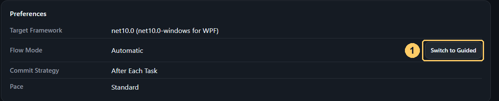
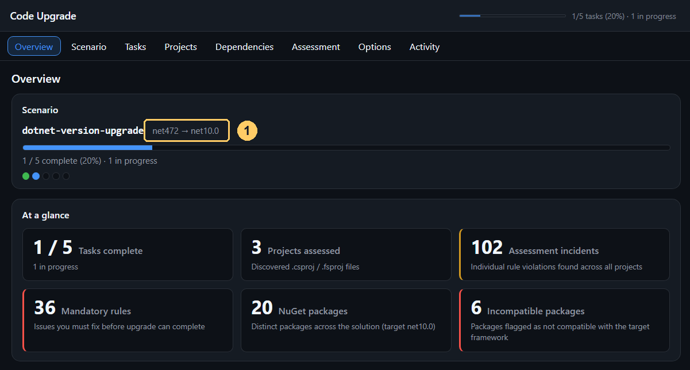
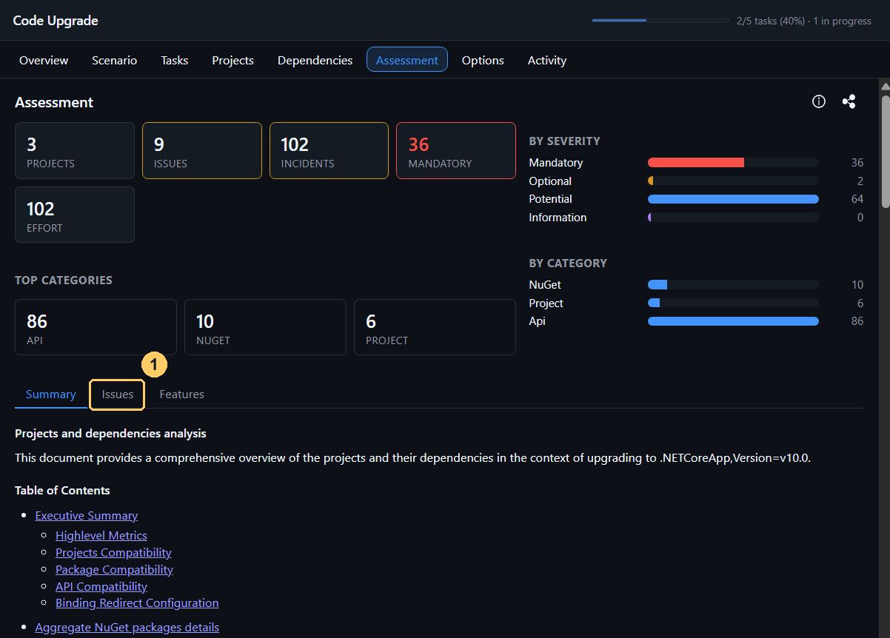
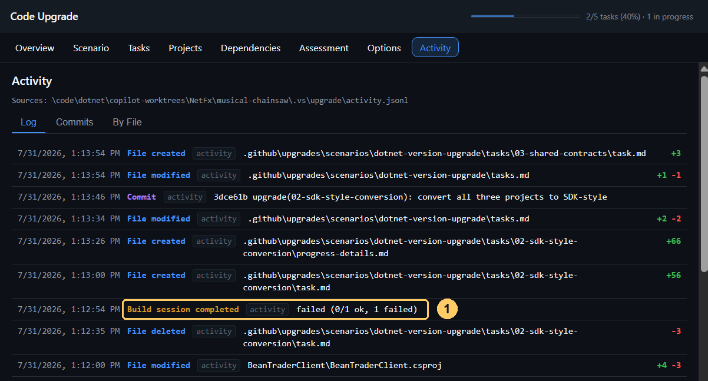

# Lab 1: Modernize OrderDesk with GitHub Copilot Upgrade

Use the **GitHub Copilot desktop app** to upgrade [OrderDesk](https://github.com/rmoreirao/orderdesk-dotnet48) from Web API 2 with OWIN self-hosting on .NET Framework 4.8 to a **controller-based ASP.NET Core API on .NET 10 LTS**.

You'll follow the agent through assessment, planning, and execution in the **Code Upgrade** dashboard, then build and test the upgraded code.

**Scope:** Keep everything local. Build and run in-memory unit tests only; don't start the API or send requests to it, connect to a database, provision Azure resources, or deploy anything. Package restore and read-only NuGet/package-analysis and documentation lookups are allowed.

**Rehearsal status:** The starter build, assessment, and plan generation completed using the standalone Copilot CLI substitute, with CLI **1.0.115-7** and Upgrade **1.1.816**. Execution then failed before the first task: the Upgrade server couldn't launch its nested CLI (`InvalidOperationException`, HRESULT `0x80131509`). A verified executable and an explicit `COPILOT_CLI_PATH` in a fresh process did not resolve it. No upgraded build or unit-test result was produced. Desktop setup, dashboard, and agent-picker interactions remain unverified.

## Prerequisites and installation

You need a Windows machine or VM, a GitHub account with Copilot access, and permission to install the tools. If you haven't installed them, use the original guides below:

| Install | Official instructions |
| --- | --- |
| Git for Windows | [Install Git on Windows](https://git-scm.com/install/windows) |
| .NET 10 SDK | [Install .NET on Windows](https://learn.microsoft.com/en-us/dotnet/core/install/windows). Install the **.NET 10 SDK**, not just the runtime. |
| .NET Framework 4.8 runtime and Developer Pack | [Download .NET Framework 4.8](https://dotnet.microsoft.com/en-us/download/dotnet-framework/net48). The **Developer Pack** supplies the reference assemblies needed to build the starter. |
| Visual Studio or Build Tools | [Visual Studio downloads](https://visualstudio.microsoft.com/downloads/). Install MSBuild and the **.NET desktop development** workload, or **.NET desktop build tools** for Build Tools. |
| GitHub Copilot desktop app | [Install and sign in to the GitHub Copilot app](https://docs.github.com/en/copilot/get-started/quickstart-copilot-app) |
| Upgrade plugin | [Install GitHub Copilot Upgrade](https://learn.microsoft.com/en-us/dotnet/core/porting/github-copilot-upgrade/install?pivots=github-copilot-app). Use the **GitHub Copilot app** instructions to install `upgrade-agent` from Microsoft's `upgrade-agent-plugins` marketplace. |
| `dotnet-test` plugin | In the app's **Customize** view, add the `dotnet/skills` marketplace and install [`dotnet-test`](https://github.com/dotnet/skills/tree/main/plugins/dotnet-test). See [GitHub's plugin guidance](https://docs.github.com/en/copilot/concepts/customizations/plugins#where-you-can-use-plugins). |

Allow access to NuGet for package restore. The .NET 10 SDK alone cannot build this legacy project. You don't need IIS, SQL Server, or an Azure subscription: OrderDesk is a console-hosted API with in-memory products and orders.

## Perform a basic upgrade

### Step 1 - Open the sample in Copilot

1. Open the **GitHub Copilot desktop app** and sign in.
2. Click **+** next to **Sessions** in the sidebar.
3. Choose **Add GitHub repository** and select `rmoreirao/orderdesk-dotnet48`. If the sample is already on your machine, choose **Open local folder** instead.
4. Set **Environment** to **This computer**.
5. Set **Workspace** to **New worktree**. This gives the upgrade its own working copy without changing your original checkout.
6. Choose **Interactive** for the app session mode, then select **Upgrade** in the agent picker.
7. Open a PowerShell terminal in the session's **worktree root**, not the original checkout, and check that the starter builds:

   ```powershell
   .\scripts\Build-Legacy.ps1
   ```

   This helper finds Visual Studio MSBuild and restores the legacy packages. Resolve any missing-tool or restore error before continuing. Don't run the generated executable; after the upgrade, use `dotnet build` instead of this legacy helper.

The starter contains `src\OrderDesk.Legacy\OrderDesk.Legacy.csproj`, not a solution file. Its controllers are `ProductsController.cs` and `OrdersController.cs`; `OrderStore.cs` holds the in-memory business logic.

**Expected result:** The original project builds, and you're ready to send the first prompt to Upgrade in the same local worktree.

### Step 2 - Start the upgrade

1. Paste this in the prompt box and send it:

   ```text
   Upgrade src\OrderDesk.Legacy\OrderDesk.Legacy.csproj from .NET Framework 4.8
   to a controller-based ASP.NET Core API on .NET 10 in Guided mode and show
   the dashboard. Keep the project at its current path. Preserve the existing
   product, order, and cancellation routes, HTTP status codes, error bodies,
   camel-case JSON, and in-memory inventory behavior.
   Keep the work local: build only during the upgrade. Do not start the API
   or send requests to it, connect to a database, provision resources, or deploy.
   Package restore and read-only NuGet/package-analysis and documentation
   lookups are allowed.
   ```

2. Answer the agent's setup questions. Use these choices when asked:

   | The agent asks about... | Your choice |
   | --- | --- |
   | Project or upgrade scope | `src\OrderDesk.Legacy\OrderDesk.Legacy.csproj`; the starter has no `.sln` |
   | Target version | .NET 10 |
   | Flow mode | Guided |
   | Git workspace | Keep the work in the current local worktree |
   | Tests before the upgrade | Skip baseline tests; the starter has none. You'll add focused unit tests later. |

3. Open the **Code Upgrade** side panel. If it didn't open automatically, send `Show the upgrade dashboard.`
4. Select **Options** and look at **Flow Mode**. If it shows **Automatic**, select **Switch to Guided**.



*1 - The button changes the Upgrade agent's flow mode. The example currently shows Automatic; this lab uses Guided. This is separate from the app's Interactive session mode.*

**Continue when:** Copilot has your upgrade choices and starts the assessment in Guided mode. Don't approve execution yet.

### Step 3 - Review the assessment

1. Select **Overview** in the dashboard.
2. Find the target framework in the scenario card. For this lab it should be `net10.0`.



*1 - Read the target here. This generic dashboard example starts at `net472`; OrderDesk starts at .NET Framework 4.8. The project and issue counts are not OrderDesk results.*

3. Select **Assessment**.
4. Open **Issues** and read a finding about an API, dependency, or project change.



*1 - Open Issues for the details. The counts in this example are not required lab results.*

5. Keep one finding in mind for the plan review. For example, `src\OrderDesk.Legacy\Startup.cs` configures Web API 2 through `System.Web.Http` and OWIN's `IAppBuilder`. The upgrade needs ASP.NET Core hosting and controller routing. The old project format and `packages.config` also need SDK-style equivalents.

**Continue when:** The assessment is ready and you can explain one change the upgrade needs to make. Copilot should now ask you to review upgrade options or proceed to planning.

### Step 4 - Answer the upgrade questions and review the plan

1. Return to the same **Upgrade** chat.
2. Review the upgrade options the agent presents. Choose **in-place** if it asks how to port the project. Choose a **controller-based ASP.NET Core API**, preserving the existing API rather than adding a UI or changing languages.
3. Confirm when the agent asks to proceed to planning. It creates the plan from the assessment and your answers; you don't need a separate plan-generation prompt.
4. When the plan is ready, select **Plan** in the dashboard. If that view isn't available, open the `plan.md` file linked in the agent's response.
5. Find the target, the response to your assessment finding, and the build step.

Use this example to understand what to look for. It illustrates plan content, not output from a completed rehearsal:

| In the plan | What it means |
| --- | --- |
| Controller-based ASP.NET Core API on .NET 10 | Copilot is upgrading the existing API, not adding a UI or replacing it with another application. |
| Replace Web API 2 and OWIN hosting with ASP.NET Core | The plan addresses the `System.Web.Http` and hosting finding you reviewed. |
| Convert the project and package references to SDK style on net48 first | The generated plan separated structural conversion from the later .NET 10 API migration, preserving behavior at each step. |
| Preserve the HTTP contract and inventory behavior | Existing routes, response bodies, status codes, and order/cancellation semantics remain intact. |
| Build the upgraded project | The plan includes a way to check the code compiles without starting a server. |

Check that the contract covers `GET /api/products`, `POST /api/orders`, `GET /api/orders/{id}`, and `POST /api/orders/{id}/cancel`. Creating an order must still return **201 Created** with its location; invalid orders, missing resources, and insufficient stock must retain their **400**, **404**, and **409** responses and error messages. Keep camel-case JSON and the single shared, in-memory inventory.

**Before you approve:** Ask Copilot to revise a missing item. Remove any proposed API launch, HTTP API check, database connection, resource provisioning, or deployment. Read the updated plan before moving on.

**Continue when:** You've reviewed the plan and are ready for Copilot to change the code.

### Step 5 - Execute the approved plan

1. Confirm when Copilot asks to move to execution. If it needs a chat reply, send:

   ```text
   Start the upgrade.
   ```

2. Select **Tasks** in the dashboard and follow a task as it moves from pending to in progress or complete.


*1 - These counts describe progress. Your task names and counts will differ from this example.*

3. Open **Activity** and inspect an event for a changed file or a build.



*1 - This example records a failed build. A completed build event is not necessarily a successful build; read the result.*

4. When the upgrade finishes, select **Changes** in the app and open the diff for `src\OrderDesk.Legacy\OrderDesk.Legacy.csproj`.
5. Look for `Microsoft.NET.Sdk.Web` and `<TargetFramework>net10.0</TargetFramework>` in the upgraded project.

If the first task reports that the **nested Copilot CLI could not be started**, stop here. Follow the tool's host-runtime diagnostics and verify its `COPILOT_CLI_PATH` before retrying in a fresh session. The rehearsal reproduced the failure even with a valid path, so don't assume installing or locating an executable alone fixes it. Don't manually port the application and count that as successful Upgrade execution.

**Continue when:** The upgrade tasks are complete and the API project targets .NET 10. If the agent is waiting for an answer, respond in the same chat. If a task fails, read the error and ask Copilot to address it before moving to validation.

### Step 6 - Build and test the upgraded code

1. In the same worktree, select **test-engineer** in the agent picker. Don't open a fresh worktree from the original branch: the tests need the upgraded code.
2. Send:

   ```text
   Add focused in-memory unit tests for the upgraded production OrderStore
   in tests\OrderDesk.Tests\OrderDesk.Tests.csproj.
   Check that ordering two units of product 1 at 19.95 each totals 39.90
   and reduces stock by two. Check that cancelling an order twice leaves it
   cancelled and restores its stock only once.
   Give each test a fresh store. The starter has a private constructor and
   a singleton; if needed, make only the smallest behavior-preserving change
   for test isolation, retaining the API's single shared inventory.
   Build the API project and run the tests. Do not start the API or send
   requests to it, connect to a database, or deploy anything.
   Package restore and read-only NuGet/package-analysis and documentation
   lookups are allowed.
   ```

3. Review the new tests in **Changes**. They must call the application's real `OrderStore` code, not duplicate its calculations or mock the store being tested. Check these observable results:

   | Behavior | What the test should check |
   | --- | --- |
   | Order creation | Product 1 has unit price `19.95m`; quantity 2 gives total `39.90m` and stock decreases by 2. |
   | Repeated cancellation | The first cancellation restores the ordered quantity; the second leaves stock unchanged and status remains `"cancelled"`. |

   Each test needs isolated state. Don't rely on test ordering or a singleton left modified by another test; any testability change must preserve the application's shared inventory.

4. Read the build and test output in chat. If it isn't shown, ask `Show the build and test output.`

| Result | What to look for |
| --- | --- |
| Build | The upgraded API and test project built with no errors. |
| Tests | The runner discovered the order creation and cancellation tests and reported them passed. |

These are expected results: the recorded CLI rehearsal stopped before upgrade execution and did not reach this test stage. Zero tests discovered is not a passing test.

**Finish when:** Your upgraded code builds and the new tests pass without starting the API. If either fails, have the agent fix it and rerun the check. A clean build and these focused unit tests don't prove HTTP compatibility or that the whole API works at runtime.

**References:** Microsoft Learn's [.NET upgrade walkthrough](https://learn.microsoft.com/en-us/dotnet/core/porting/github-copilot-upgrade/dotnet-how-to-upgrade-with-github-copilot) and [dashboard guide](https://learn.microsoft.com/en-us/dotnet/core/porting/github-copilot-upgrade/dashboard). [Image credits](../../images/lab-1/ATTRIBUTION.txt).
