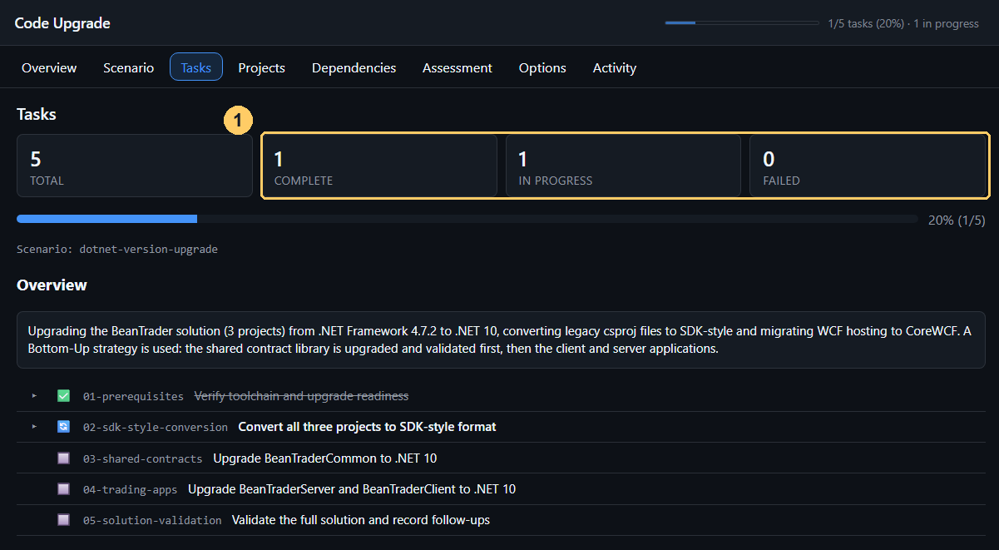

# Lab 1: Modernize Contoso University with GitHub Copilot Upgrade

Use the **GitHub Copilot desktop app** to upgrade [Contoso University](https://github.com/Azure-Samples/dotnet-migration-copilot-samples/tree/main/ContosoUniversity) from ASP.NET MVC 5 on .NET Framework 4.8 to **ASP.NET Core MVC on .NET 10 LTS**.

You'll follow the agent through assessment, planning, and execution in the **Code Upgrade** dashboard, then build and test the upgraded code.

**Scope:** Keep everything local. Don't run the web app, connect to a database, or deploy anything.


## Prerequisites and installation

You need a Windows machine or VM, a GitHub account with Copilot access, and permission to install the tools. If you haven't installed them, use the original guides below:

| Install | Official instructions |
| --- | --- |
| Git for Windows | [Install Git on Windows](https://git-scm.com/install/windows) |
| .NET 10 SDK | [Install .NET on Windows](https://learn.microsoft.com/en-us/dotnet/core/install/windows). Install the **.NET 10 SDK**, not just the runtime. |
| GitHub Copilot desktop app | [Install and sign in to the GitHub Copilot app](https://docs.github.com/en/copilot/get-started/quickstart-copilot-app) |
| Upgrade plugin | [Install GitHub Copilot Upgrade](https://learn.microsoft.com/en-us/dotnet/core/porting/github-copilot-upgrade/install?pivots=github-copilot-app). Use the **GitHub Copilot app** instructions to install `upgrade-agent` from Microsoft's `upgrade-agent-plugins` marketplace. |
| `dotnet-test` plugin | In the app's **Customize** view, add the `dotnet/skills` marketplace and install [`dotnet-test`](https://github.com/dotnet/skills/tree/main/plugins/dotnet-test). See [GitHub's plugin guidance](https://docs.github.com/en/copilot/concepts/customizations/plugins#where-you-can-use-plugins). |

You don't need IIS Express, SQL Server LocalDB, MSMQ, or an Azure subscription.

## Perform a basic upgrade

### Step 1 - Open the sample in Copilot

1. Open the **GitHub Copilot desktop app** and sign in.
2. Click **+** next to **Sessions** in the sidebar.
3. Choose **Add GitHub repository** and select `Azure-Samples/dotnet-migration-copilot-samples`. If the sample is already on your machine, choose **Open local folder** instead.
4. Set **Environment** to **This computer**.
5. Set **Workspace** to **New worktree**. This gives the upgrade its own working copy without changing your original checkout.
6. Choose **Interactive** for the app session mode, then select **Upgrade** in the agent picker.

**Expected result:** You're ready to send the first prompt to Upgrade in a local session for the sample.

### Step 2 - Start the upgrade

1. Paste this in the prompt box and send it:

   ```text
   Upgrade my solution to .NET 10 in Guided mode and show the dashboard.
   ```

2. Answer the agent's setup questions. Use these choices when asked:

   | The agent asks about... | Your choice |
   | --- | --- |
   | Solution | `ContosoUniversity\ContosoUniversity.sln` |
   | Target version | .NET 10 |
   | Flow mode | Guided |
   | Git workspace | Keep the work in the current local worktree |
   | Tests before the upgrade | Skip the baseline; you'll create a focused test later |

3. Open the **Code Upgrade** side panel. If it didn't open automatically, send `Show the upgrade dashboard.`
4. Select **Options** and look at **Flow Mode**. If it shows **Automatic**, select **Switch to Guided**.


*1 - The button changes the Upgrade agent's flow mode. The example currently shows Automatic; this lab uses Guided. This is separate from the app's Interactive session mode.*

**Continue when:** Copilot has your upgrade choices and starts the assessment in Guided mode. Don't approve execution yet.

### Step 3 - Review the assessment

1. Select **Overview** in the dashboard.
2. Find the target framework in the scenario card. For this lab it should be `net10.0`.


*1 - Read the target here. The example starts at `net472`; Contoso University starts at .NET Framework 4.8.*

3. Select **Assessment**.
4. Open **Issues** and read a finding about an API, dependency, or project change.


*1 - Open Issues for the details. The counts in this example are not required lab results.*

5. Keep one finding in mind for the plan review. For example, Contoso University's `App_Start\RouteConfig.cs` uses legacy `System.Web` routing. The upgrade needs to move routing into ASP.NET Core.

**Continue when:** The assessment is ready and you can explain one change the upgrade needs to make. Copilot should now ask you to review upgrade options or proceed to planning.

### Step 4 - Answer the upgrade questions and review the plan

1. Return to the same **Upgrade** chat.
2. Review the upgrade options the agent presents. Choose **in-place** if it asks how to port the project. Keep **MVC** as the application model; the lab isn't a UI redesign.
3. Confirm when the agent asks to proceed to planning. It creates the plan from the assessment and your answers; you don't need a separate plan-generation prompt.
4. When the plan is ready, select **Plan** in the dashboard. If that view isn't available, open the `plan.md` file linked in the agent's response.
5. Find the target, the response to your assessment finding, and the build step.

Use this example to understand what to look for. It illustrates plan content, not output from a completed rehearsal:

| In the plan | What it means |
| --- | --- |
| ASP.NET Core MVC on .NET 10 | Copilot is upgrading the existing web app, not choosing a different application type. |
| Replace legacy routing with ASP.NET Core routing | The plan addresses the `System.Web` finding you reviewed. |
| Build the upgraded solution | The plan includes a way to check the code compiles. |

**Before you approve:** Ask Copilot to revise a missing item. Remove any proposed app launch, database connection, or deployment. Read the updated plan before moving on.

**Continue when:** You've reviewed the plan and are ready for Copilot to change the code.

### Step 5 - Execute the approved plan

1. Confirm when Copilot asks to move to execution. If it needs a chat reply, send:

   ```text
   Start the upgrade.
   ```

2. Select **Tasks** in the dashboard and follow a task as it moves from pending to in progress or complete.



*1 - These counts describe progress. Your task names and counts will differ from this example.*

3. Open **Activity** and inspect an event for a changed file or a build.


*1 - This example records a failed build. A completed build event is not necessarily a successful build; read the result.*

4. When the upgrade finishes, select **Changes** in the app and open the web project's `.csproj` diff.
5. Look for `<TargetFramework>net10.0</TargetFramework>` in the upgraded project.

**Continue when:** The upgrade tasks are complete and the web project targets .NET 10. If the agent is waiting for an answer, respond in the same chat. If a task fails, read the error and ask Copilot to address it before moving to validation.

### Step 6 - Build and test the upgraded code

1. In the same worktree, select **test-engineer** in the agent picker. Don't open a fresh worktree from the original branch: the tests need the upgraded code.
2. Send:

   ```text
   Add an in-memory unit test for PaginatedList. Build the solution and run the test.
   ```

3. Review the new test in **Changes**. It should call the application's `PaginatedList` code and check the students returned for a page. For example, the second page of a four-student list, with two students per page, should contain the last two students.
4. Read the build and test output in chat. If it isn't shown, ask `Show the build and test output.`

| Result | What to look for |
| --- | --- |
| Build | The upgraded solution built with no errors. |
| Test | The runner discovered the new test and reported it passed. |

These are expected results, not recorded outcomes from a rehearsal. Zero tests discovered is not a passing test.

**Finish when:** Your upgraded code builds and the new test passes. If either fails, have the agent fix it and rerun the check. A clean build and this focused test don't prove the whole web app works at runtime.

**References:** Microsoft Learn's [.NET upgrade walkthrough](https://learn.microsoft.com/en-us/dotnet/core/porting/github-copilot-upgrade/dotnet-how-to-upgrade-with-github-copilot) and [dashboard guide](https://learn.microsoft.com/en-us/dotnet/core/porting/github-copilot-upgrade/dashboard). [Image credits](../../images/lab-1/ATTRIBUTION.txt).
