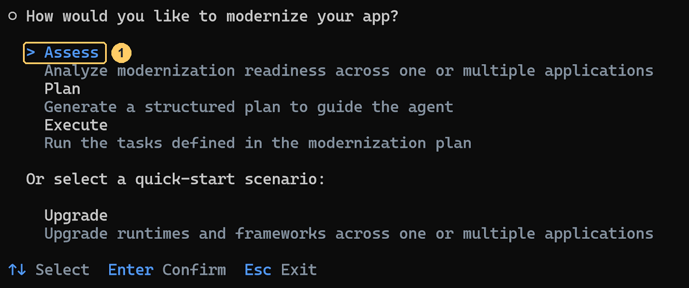
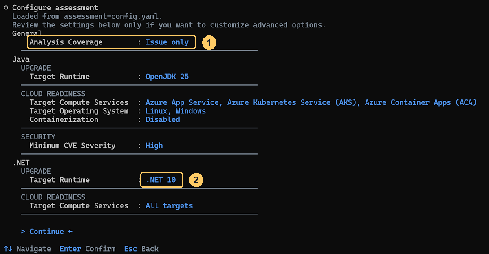

# Lab 2: Modernize OrderDesk with the Modernize CLI

Use the **GitHub Copilot Modernization Agent** to upgrade the same [OrderDesk API](https://github.com/rmoreirao/orderdesk-dotnet48) as Lab 1, this time from the terminal. Follow its **Assess > Plan > Execute** workflow, review the generated plan, and build and test the upgraded code.

**Scope:** Upgrade Web API 2 with OWIN self-hosting on .NET Framework 4.8 to a controller-based ASP.NET Core API on .NET 10. Keep the work local: build and in-memory unit tests only, with no API startup, HTTP requests, database connections, Azure migration, resource provisioning, or deployment.

## Prerequisites and installation

Use a Windows machine and a GitHub account with Copilot access. You can reuse Git, the SDK, and the legacy build tools from Lab 1, but this lab doesn't require the desktop app or its plugins.

| Install | Official instructions |
| --- | --- |
| Git for Windows | [Install Git](https://git-scm.com/install/windows) |
| GitHub CLI | [Install GitHub CLI](https://cli.github.com/) |
| .NET 10 SDK | [Install .NET on Windows](https://learn.microsoft.com/en-us/dotnet/core/install/windows). Choose the SDK, not just the runtime. |
| .NET Framework 4.8 runtime and Developer Pack | [Download .NET Framework 4.8](https://dotnet.microsoft.com/en-us/download/dotnet-framework/net48). Install the **Developer Pack** for the legacy reference assemblies. |
| Visual Studio or Build Tools | [Visual Studio downloads](https://visualstudio.microsoft.com/downloads/). Install MSBuild and the **.NET desktop development** workload, or **.NET desktop build tools** for Build Tools. |
| Modernize CLI | [Install the Modernization Agent](https://learn.microsoft.com/en-us/azure/developer/github-copilot-app-modernization/modernization-agent/quickstart#install-the-modernization-agent). Open a new terminal after installing it. |

Allow access to NuGet for package restore. The .NET 10 SDK alone cannot build the starter. No Azure subscription, IIS, or database is needed; OrderDesk stores its products and orders in memory.

**Rehearsal limitation:** With Modernize CLI **1.0.95**, the starter build and local assessment completed, but plan creation failed with `extensionSdkPath is required when standalone extensions are requested`. No upgraded build or test run was reached. The rehearsal used non-interactive CLI commands; menu interactions remain unverified. The steps below describe the intended workflow, not a successful end-to-end run on that version. See the planning error guidance in Step 4.

## Step 1 - Open a fresh copy of the sample

1. Open **PowerShell** from the Windows Start menu in the folder where you keep your projects.
2. Clone the original sample into a separate Lab 2 folder. Don't use the worktree upgraded in Lab 1:

   ```powershell
   git clone https://github.com/rmoreirao/orderdesk-dotnet48.git orderdesk-dotnet48-lab2
   Set-Location .\orderdesk-dotnet48-lab2
   ```

3. Check that the original project builds:

   ```powershell
   .\scripts\Build-Legacy.ps1
   ```

   The helper locates Visual Studio MSBuild and restores the legacy packages. Resolve any missing-tool or restore error before continuing. Don't run the generated executable. This helper is for the starter only; use `dotnet build` after modernization.

4. If GitHub CLI isn't signed in, run:

   ```powershell
   gh auth login
   ```

5. Sign in using the GitHub account with Copilot access.
6. Start the interactive CLI from the repository root:

   ```powershell
   modernize
   ```



*Official menu example. 1 - Use the arrow keys to select Assess, then press Enter.*

The starter has a single project, `src\OrderDesk.Legacy\OrderDesk.Legacy.csproj`, and no solution or test project. Keep the CLI at the repository root so it can also see the build script and configuration.

**Continue when:** The starter builds and the Modernize menu is open for the original OrderDesk source.

## Step 2 - Select the assessment scope

1. Choose **Assess**.
2. Choose **Current folder** as the source.


*1 - Choose Current folder. Your path should end in `orderdesk-dotnet48-lab2`, not the example's folder.*

3. If the CLI asks you to select repositories or projects, keep only the entry for **OrderDesk.Legacy** selected. Project discovery may name it `orderdesk-dotnet48-lab2.src.OrderDesk.Legacy` rather than just the clone folder.
4. Under **assessment domains**, select **Upgrade** only. Use **Space** to deselect **Cloud Readiness** or **Security** if they're selected.


*Official example with all domains selected. For this lab, keep only 1 - Upgrade.*

5. On the configuration screen, choose **Issue only** for **Analysis Coverage** and **.NET 10** for the .NET upgrade target.



*1 - Issue only. 2 - .NET 10. The example includes other domains; Java and cloud settings aren't part of this lab.*

6. Select **Continue**.
7. Choose **Assess locally**, not **Delegate to Cloud Agents**.


*1 - Run the assessment on this computer.*

8. Accept the proposed output folder and start the assessment.

**Expected result:** The CLI assesses one local application and produces a report. It hasn't migrated the code or deployed anything.

## Step 3 - Review the assessment

1. Open the report the CLI produces. If it doesn't open automatically, open `index.html` at the output path shown in the terminal.
2. Find the **OrderDesk** application or **OrderDesk.Legacy** project in the report; the application may be labeled with the clone folder name.
3. Confirm the current framework is **.NET Framework 4.8**. The initial report may not contain the .NET 10 target or detailed framework-upgrade findings; confirm that target explicitly when creating the plan.
4. Open the application's details and compare a reported finding with the source. In the **1.0.95** rehearsal, the report listed **Hardcoded URLs detected** in `Program.cs` and a connection-string configuration finding in `App.config`, under **Cloud Readiness Issues**, even though the assessment metadata recorded Upgrade only. `App.config` contains a local listen URL, not a database connection string. Don't turn these findings into Azure or database tasks.
5. Separately inspect `src\OrderDesk.Legacy\Startup.cs` to identify a real upgrade concern: it uses `System.Web.Http` and OWIN's `IAppBuilder` to configure Web API 2. These need ASP.NET Core hosting and controller routing. The legacy `.csproj` format and `packages.config` also need SDK-style equivalents. These are source-review observations, not findings guaranteed to appear in the initial report.

The menu images above are generic interface examples, not results from an OrderDesk run. Use the report generated for your local clone; finding counts and wording may differ.

**Continue when:** You can identify the app's starting framework and one source-backed change to look for in the plan. Keep .NET 10 as the explicit planning goal, and leave the report's Azure recommendations out of this lab.

## Step 4 - Create the local modernization plan

1. Return to the terminal. At **How would you like to continue?**, choose **Create modernization plan**.
2. Choose **Keep the plan local**.
3. Keep the assessment you just generated as the planning input.
4. Set the plan name to `orderdesk-dotnet10`.
5. Replace the default modernization goal with:

   ```text
   Upgrade src\OrderDesk.Legacy\OrderDesk.Legacy.csproj from .NET Framework 4.8
   to a controller-based ASP.NET Core API on .NET 10, keeping its current path.
   Preserve GET /api/products, POST /api/orders, GET /api/orders/{id}, and
   POST /api/orders/{id}/cancel, including status codes, the created order's
   location, error bodies, camel-case JSON, and single shared in-memory inventory.
   Add focused in-memory tests in tests\OrderDesk.Tests\OrderDesk.Tests.csproj.
   Verify that two units of product 1 at 19.95 each total 39.90 and reduce stock
   by two, and that cancelling twice restores stock only once.
   Give each test a fresh store; if the private constructor and singleton prevent
   isolation, make only the smallest behavior-preserving testability change.
   Build and run the unit tests only. Do not start the API, make HTTP requests,
   connect to a database, migrate to Azure, provision resources, or deploy.
   ```

   The default goal includes migrating to Azure. Don't accept that default for this lab.

6. Answer the agent's questions using these choices:

   | When asked about... | Choose... |
   | --- | --- |
   | Project or upgrade scope | `src\OrderDesk.Legacy\OrderDesk.Legacy.csproj`; the starter has no `.sln` |
   | Application model | Controller-based ASP.NET Core API |
   | Target framework | .NET 10 |
   | Upgrade approach | In-place |
   | Azure services, infrastructure, or deployment | No |
   | Validation | Build and isolated in-memory order creation/cancellation tests; don't start the API |

7. When the plan is ready, leave the CLI at its continuation menu while you review the files. Don't choose execution yet.

**Expected result:** Copilot creates a local plan from the assessment and your answers.

**If planning fails:** The recorded **1.0.95** failure was `Request session.create failed ... Failed to initialize standalone session extensions: extensionSdkPath is required when standalone extensions are requested`. It happened before a plan was generated and also reproduced with process-local plugin-discovery isolation. Stop here rather than treating assessment success as a completed upgrade. Check the [Modernize CLI releases](https://github.com/microsoft/modernize-cli/releases) for a supported fix, then rerun planning before continuing. Don't disable required Upgrade functionality or manually rewrite the application and call that a CLI rehearsal.

## Step 5 - Review the plan before executing

1. Open `.github\modernize\orderdesk-dotnet10\plan.md` in a text editor.
2. Find a **controller-based ASP.NET Core API on .NET 10** as the target, keeping `src\OrderDesk.Legacy\OrderDesk.Legacy.csproj` as the API project.
3. Look for the migration work that addresses your source-backed upgrade concern: replace Web API 2 and OWIN hosting with ASP.NET Core, and convert the project and package references to SDK style.
4. Check that the plan preserves the four API routes, camel-case JSON, error messages, and status codes. Order creation must keep **201 Created** and its location; invalid orders, missing resources, and insufficient stock must retain **400**, **404**, and **409** responses.
5. Find the isolated in-memory order tests, their test-project path, and build validation. Testability changes must preserve the application's single shared inventory rather than creating a different store for every request.
6. Open the task file linked by the CLI in the same plan folder to see execution tasks and dependencies. Its location can vary by version, for example `tasks.json` or `.metadata\tasks.json`. A dependency CVE-remediation task may also appear.
7. If the plan contains Azure migration, resource provisioning, deployment, database access, API startup, or HTTP checks, have the agent revise it before approving.

Use these as review criteria, not as output from a recorded run:

| In the plan | What to check |
| --- | --- |
| API migration | ASP.NET Core replaces the legacy host and controllers without adding a UI or changing languages. |
| Order creation test | Calling production `OrderStore` with product 1 and quantity 2 gives total `39.90m` at unit price `19.95m`, with stock reduced by 2. |
| Repeated cancellation test | Cancelling restores the ordered quantity once; a second cancellation leaves stock unchanged and status remains `"cancelled"`. |
| Validation | Build the upgraded project and discover and run the unit tests without a server or database. |

**Continue when:** The plan upgrades the existing API and includes the focused tests, with no API startup or Azure work.

## Step 6 - Execute the reviewed plan

1. Return to the same CLI session.
2. Choose **Execute modernization plan** after reviewing the plan.
3. Confirm local execution.
4. Follow the task progress in the terminal. Respond to any questions the agent asks before moving on.
5. When execution finishes, review `src\OrderDesk.Legacy\OrderDesk.Legacy.csproj`. Confirm it uses `Microsoft.NET.Sdk.Web` and `<TargetFramework>net10.0</TargetFramework>`.

**Continue when:** The local upgrade has completed and the project targets .NET 10. A failed or unfinished task is not a completed upgrade.

## Step 7 - Build and check the tests

1. From the upgraded repository root, build the API project:

   ```powershell
   dotnet build .\src\OrderDesk.Legacy\OrderDesk.Legacy.csproj
   ```

2. Run its tests:

   ```powershell
   dotnet test .\tests\OrderDesk.Tests\OrderDesk.Tests.csproj
   ```

   This is the test-project location requested in the goal, not a project included in the starter. If the agent reports a different generated location, use that actual path.

3. Open the generated tests. They must call the application's real `OrderStore`, not copied business logic or a mocked store. Check the order total, stock reduction, cancellation status, and stock after each cancellation against the plan's criteria.
4. Check that each test gets isolated state. Don't rely on test ordering or leftover singleton state; any testability change must preserve the API's single shared inventory.
5. Read the build and test results. The build must succeed, and the test runner must discover and pass the order creation and cancellation tests.

These are expected outcomes, not recorded successful OrderDesk rehearsal results: the 1.0.95 run stopped during planning. Zero tests discovered is not a passing test.

**Finish when:** The upgraded code builds and the focused unit tests pass without starting the API, making HTTP requests, or connecting to a database. These checks don't prove HTTP compatibility or that the whole API works at runtime. Keep your changes local.

**References:** [Modernization Agent overview](https://learn.microsoft.com/en-us/azure/developer/github-copilot-app-modernization/modernization-agent/overview), [interactive quickstart](https://learn.microsoft.com/en-us/azure/developer/github-copilot-app-modernization/modernization-agent/quickstart), and [image credits](../../images/lab-2/ATTRIBUTION.txt).
