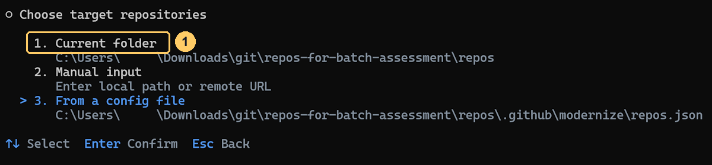
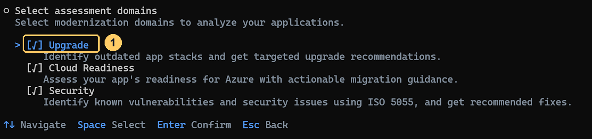
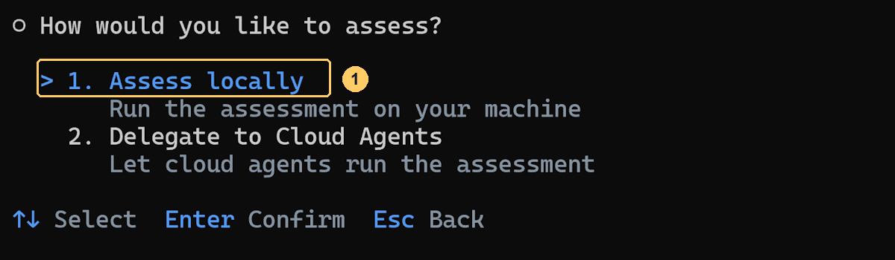
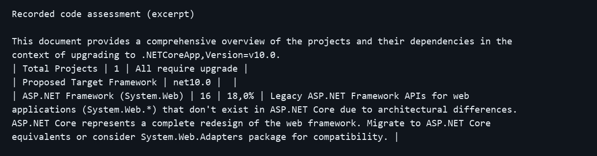
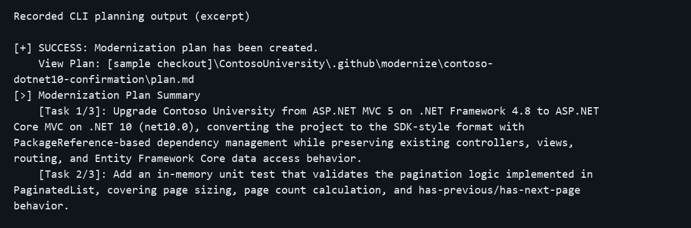
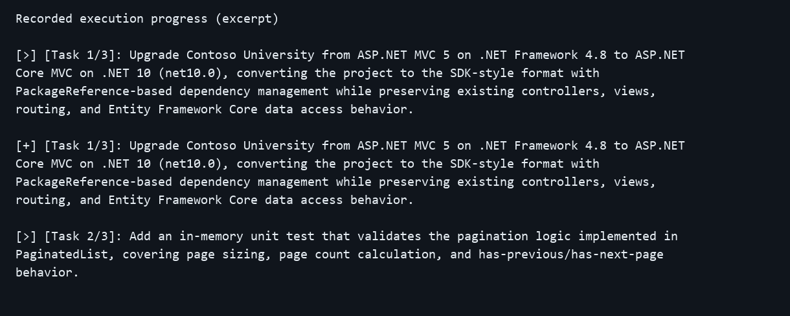
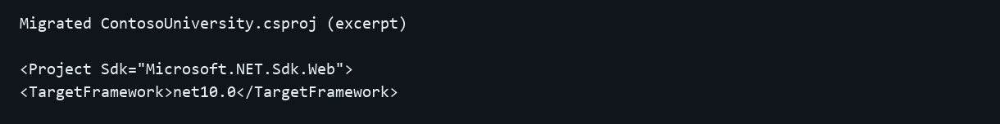
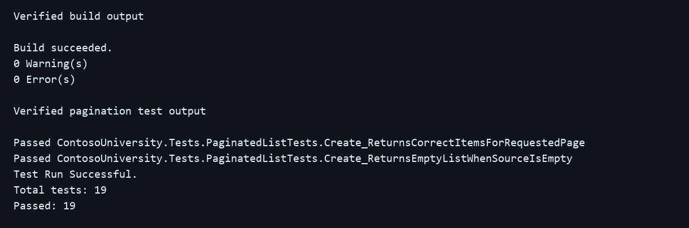

# Lab 2: Modernize Contoso University with the Modernize CLI

Use the **GitHub Copilot Modernization Agent** to upgrade the same Contoso University application as Lab 1, this time from the terminal. Follow its **Assess > Plan > Execute** workflow, review the generated plan, and build and test the upgraded code.

**Scope:** Upgrade ASP.NET MVC 5 on .NET Framework 4.8 to ASP.NET Core MVC on .NET 10. Keep the work local: no Azure migration, resource provisioning, deployment, or web app startup.

## Prerequisites and installation

Use a Windows machine and a GitHub account with Copilot access. You can reuse Git and the .NET SDK from Lab 1, but this lab doesn't require the desktop app or its Upgrade plugin.

| Install | Official instructions |
| --- | --- |
| Git for Windows | [Install Git](https://git-scm.com/install/windows) |
| GitHub CLI | [Install GitHub CLI](https://cli.github.com/) |
| .NET 10 SDK | [Install .NET on Windows](https://learn.microsoft.com/en-us/dotnet/core/install/windows). Choose the SDK, not just the runtime. |
| Modernize CLI | [Install the Modernization Agent](https://learn.microsoft.com/en-us/azure/developer/github-copilot-app-modernization/modernization-agent/quickstart#install-the-modernization-agent). Open a new terminal after installing it. |

No Azure subscription, LocalDB, or MSMQ installation is needed.

## Step 1 - Open a fresh copy of the sample

1. Open **PowerShell** from the Windows Start menu in the folder where you keep your projects.
2. Clone the original sample into a separate Lab 2 folder. Don't use the worktree upgraded in Lab 1:

   ```powershell
   git clone https://github.com/Azure-Samples/dotnet-migration-copilot-samples.git contoso-university-lab2
   Set-Location .\contoso-university-lab2\ContosoUniversity
   ```

3. If GitHub CLI isn't signed in, run:

   ```powershell
   gh auth login
   ```

4. Sign in using the GitHub account with Copilot access.
5. Start the interactive CLI:

   ```powershell
   modernize
   ```


*Official menu example. 1 - Use the arrow keys to select Assess, then press Enter.*

**Continue when:** The Modernize menu is open for the original Contoso University source.

## Step 2 - Select the assessment scope

1. Choose **Assess**.
2. Choose **Current folder** as the source.



*1 - Choose Current folder. Your path should end in `contoso-university-lab2\ContosoUniversity`, not the example's folder.*

3. If the CLI asks you to select repositories, keep only **ContosoUniversity** selected.
4. Under **assessment domains**, select **Upgrade** only. Use **Space** to deselect **Cloud Readiness** or **Security** if they're selected.



*Official example with all domains selected. For this lab, keep only 1 - Upgrade.*

5. On the configuration screen, choose **Issue only** for **Analysis Coverage** and **.NET 10** for the .NET upgrade target.


*1 - Issue only. 2 - .NET 10. The example includes other domains; Java and cloud settings aren't part of this lab.*

6. Select **Continue**.
7. Choose **Assess locally**, not **Delegate to Cloud Agents**.



*1 - Run the assessment on this computer.*

8. Accept the proposed output folder and start the assessment.

**Expected result:** The CLI assesses one local application and produces a report. It hasn't migrated the code or deployed anything.

## Step 3 - Review the assessment

1. Open the report the CLI produces. If it doesn't open automatically, open `index.html` at the output path shown in the terminal.
2. Find **ContosoUniversity** in the report.
3. Read its current framework and upgrade recommendation. Look for **.NET Framework 4.8** and the recommendation to move to **.NET 10**.
4. Open the application's details and read a code compatibility finding. For example, the existing app uses `System.Web` for MVC and routing, which needs an ASP.NET Core replacement.



*Code assessment produced by the upgrade engine during the rehearsal, reformatted as an excerpt. Your initial report may arrange the findings differently.*

**Continue when:** You can identify the app's starting framework, the upgrade target, and one issue to look for in the plan. If the report also contains Azure recommendations, leave them out of this lab's plan.

## Step 4 - Create the local modernization plan

1. Return to the terminal. At **How would you like to continue?**, choose **Create modernization plan**.
2. Choose **Keep the plan local**.
3. Keep the assessment you just generated as the planning input.
4. Set the plan name to `contoso-dotnet10`.
5. Replace the default modernization goal with:

   ```text
   Upgrade to .NET 10 and add an in-memory pagination test. Do not migrate to Azure.
   ```

   The default goal includes migrating to Azure. Don't accept that default for this lab.

6. Answer the agent's questions using these choices:

   | When asked about... | Choose... |
   | --- | --- |
   | Application model | ASP.NET Core MVC |
   | Target framework | .NET 10 |
   | Upgrade approach | In-place |
   | Azure services, infrastructure, or deployment | No |
   | Validation | Build and an in-memory pagination test; don't launch the web app |

7. When the plan is ready, leave the CLI at its continuation menu while you review the files. Don't choose execution yet.

**Expected result:** Copilot creates a local plan from the assessment and your answers.

## Step 5 - Review the plan before executing

1. Open `.github\modernize\contoso-dotnet10\plan.md` in a text editor.
2. Find **ASP.NET Core MVC on .NET 10** as the target.
3. Look for the migration work that addresses your assessment finding. For example, the plan should replace the old `System.Web` hosting and routing with ASP.NET Core equivalents.
4. Find the in-memory pagination test and build validation.



*Rehearsal output, reformatted from the real CLI log. The local path is shortened. Your plan name and task wording may differ.*

5. Open `.metadata\tasks.json` in the same plan folder to see the execution tasks and their dependencies. A dependency CVE-remediation task may also appear.
6. If the plan contains Azure migration, deployment, database access, or app-startup tasks, have the agent revise it before approving.

**Continue when:** The plan upgrades the existing MVC application and includes the test, with no Azure work.

## Step 6 - Execute the reviewed plan

1. Return to the same CLI session.
2. Choose **Execute modernization plan** after reviewing the plan.
3. Confirm local execution.
4. Follow the task progress in the terminal. Respond to any questions the agent asks before moving on.



*Rehearsal progress, reformatted from the CLI log: `[>]` starts a task and `[+]` marks its completion. This excerpt shows the transition to testing, not the end of the whole run.*

5. When execution finishes, review the changed web project and confirm it targets `net10.0`.



*Project-file excerpt from the local rehearsal. The upgrade moved the app to the ASP.NET Core web SDK and .NET 10.*

**Continue when:** The local upgrade has completed and the project targets .NET 10. A failed or unfinished task is not a completed upgrade.

## Step 7 - Build and check the test

1. From the upgraded application folder, build the solution:

   ```powershell
   dotnet build .\ContosoUniversity.sln
   ```

2. Run its tests:

   ```powershell
   dotnet test .\ContosoUniversity.Tests\ContosoUniversity.Tests.csproj
   ```

   These are the paths generated in the rehearsal. If your agent chooses different names, use the solution and test-project paths it reports.

3. Open the generated pagination test. It should use an in-memory list and call the application's pagination code, not a copy of that code inside the test. In the rehearsal, `Create_ReturnsCorrectItemsForRequestedPage` checked that page two returned items 11 through 20 from a 30-item list.
4. Read the build and test results. The build must succeed, and the test runner must discover and pass the pagination test.



*Actual verification output, reformatted for readability. The rehearsal discovered and passed 19 tests; your agent may generate a different number. Zero tests discovered is not a passing test.*

**Finish when:** The upgraded code builds and the pagination test passes without starting the app or connecting to a database. Keep your changes local.

**References:** [Modernization Agent overview](https://learn.microsoft.com/en-us/azure/developer/github-copilot-app-modernization/modernization-agent/overview), [interactive quickstart](https://learn.microsoft.com/en-us/azure/developer/github-copilot-app-modernization/modernization-agent/quickstart), and [image credits](../../images/lab-2/ATTRIBUTION.txt).
